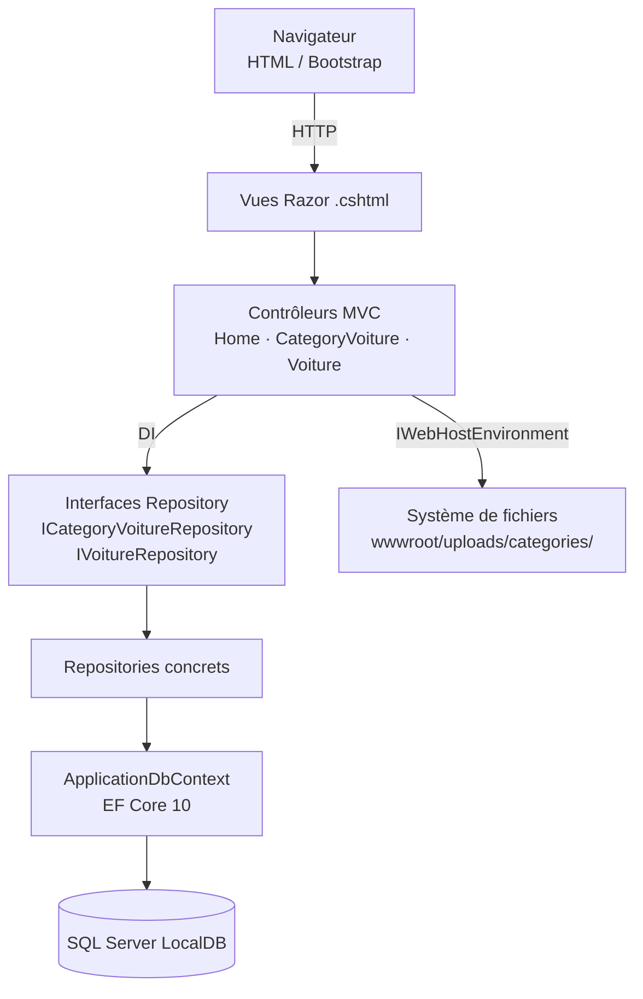
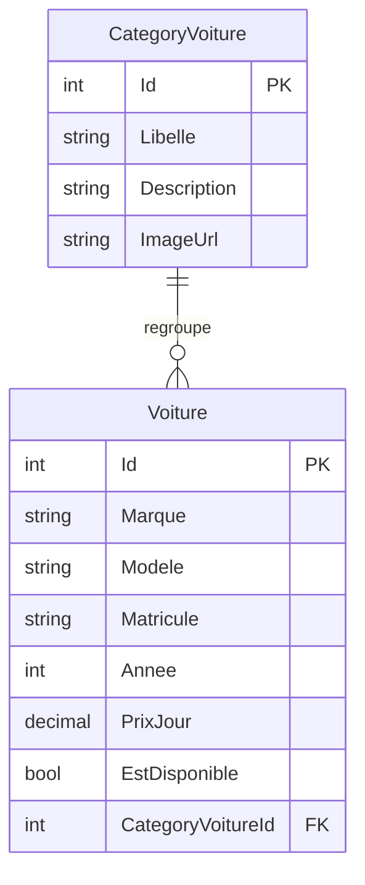
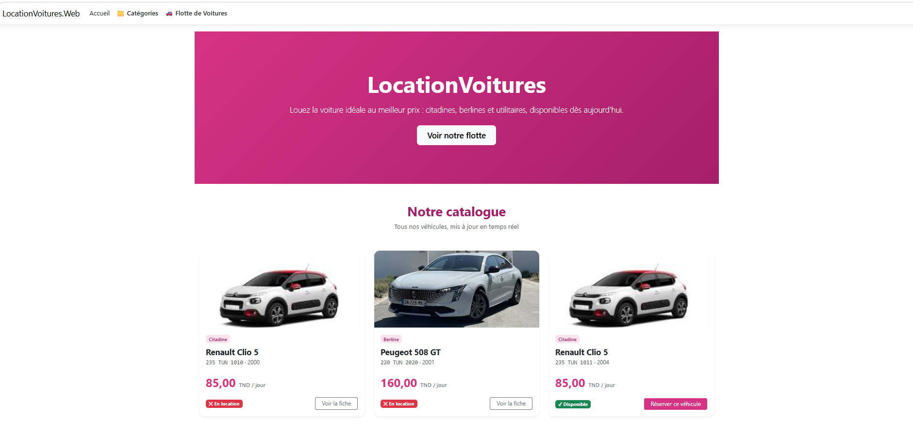
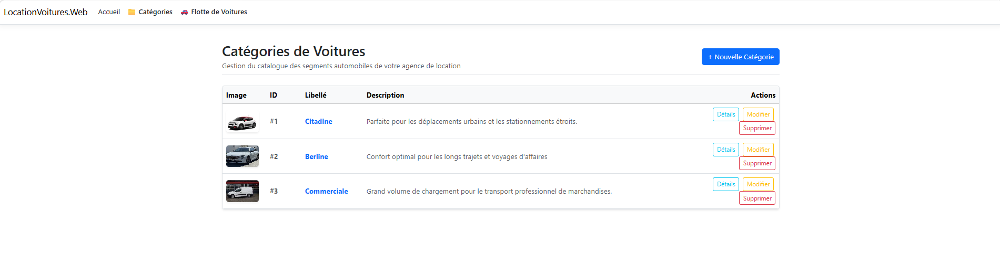
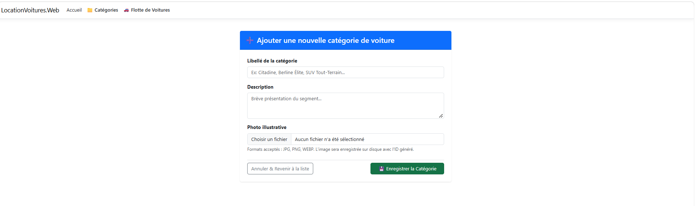
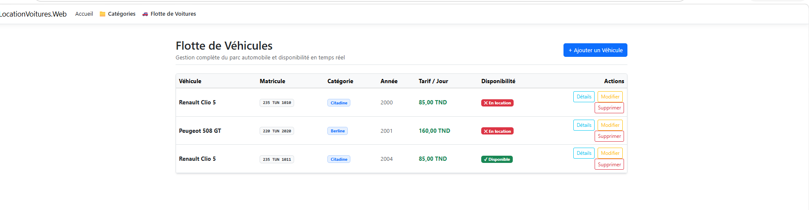
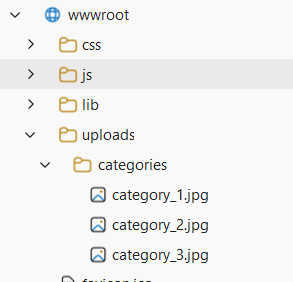
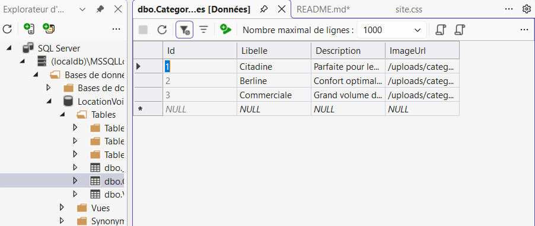

# 🚗 LocationVoitures — Application web de location de voitures

> Mini-projet **ASP.NET Core 10 MVC** · **Entity Framework Core** · **SQL Server LocalDB** · **Repository Pattern** · Upload d'images sur disque · Vitrine dynamique

**TP Séance 2 — Programmation Web & Architecture MVC**
Maram Ben Moallem 3LTIC IOT
ENET'Com (École Nationale d'Électronique et des Télécommunications de Sfax) · Université de Sfax

---

## 📖 Présentation

**LocationVoitures** est l'application web de gestion et de vitrine de mon agence de location de voitures.

Elle fait évoluer le site vitrine statique du **TP Séance 1** (HTML / CSS / JavaScript / Bootstrap), dont toutes les données étaient écrites en dur, vers une **application web dynamique côté serveur** :

- les **catégories** et les **véhicules** sont stockés en base de données SQL Server ;
- un **back-office CRUD** permet de les gérer (avec upload d'images) ;
- la **page d'accueil** affiche en direct le catalogue depuis la base de données, avec la charte graphique rosée du TP 1.

---

## ✨ Fonctionnalités

| Partie | Module | Description |
|---|---|---|
| 1 | **Socle du projet** | Projet MVC .NET 10, EF Core 10, chaîne de connexion LocalDB, injection de dépendances |
| 2 | **Catégories** | CRUD complet (libellé, description, photo) avec upload physique sur disque |
| 3 | **Flotte** | CRUD des voitures, relation **1-N** avec les catégories, *Eager Loading* via `.Include()`, liste déroulante dynamique |
| 4 | **Vitrine client** | Page d'accueil dynamique : hero, grille de cartes responsive, badges de disponibilité, état « aucun véhicule » |

**Points techniques notables :**
- Image enregistrée sur le disque (`wwwroot/uploads/categories/category_{id}.jpg`) ; seule l'**URL relative** est stockée en base.
- Suppression/remplacement du fichier image synchronisés avec la base.
- Validation côté client (jQuery Validation) et côté serveur (`ModelState`, Data Annotations).
- Prévisualisation instantanée de l'image avant l'envoi du formulaire.
- Aucun accès direct au `DbContext` dans les contrôleurs : tout passe par les repositories.

---

## 🛠️ Technologies

- **ASP.NET Core 10.0 MVC** (.NET 10, C#)
- **Entity Framework Core 10** — approche *Code-First* et migrations
- **SQL Server LocalDB**
- **Razor**, Tag Helpers, **Bootstrap 5**, CSS 
- **Repository Pattern** + injection de dépendances (cycle de vie *Scoped*)
- **Visual Studio 2022**

---

## 🏗️ Architecture



**Pourquoi disque + base ?** Stocker des images en `VARBINARY(MAX)` dégrade les performances et alourdit les sauvegardes. Le fichier est écrit sur le disque du serveur et seule son URL relative (ex. `/uploads/categories/category_1.jpg`) est enregistrée en base.

### Modèle de données



---

## 📁 Structure du projet

```
LocationVoitures/
└── LocationVoitures.Web/
    ├── Controllers/
    │   ├── HomeController.cs              ← injecte IVoitureRepository (Partie 4)
    │   ├── CategoryVoitureController.cs
    │   └── VoitureController.cs
    ├── Data/
    │   └── ApplicationDbContext.cs
    ├── Migrations/
    │   ├── ..._InitialCreateCategory.cs
    │   └── ..._AddVoitureEntityAndRelation.cs
    ├── Models/
    │   ├── CategoryVoiture.cs
    │   └── Voiture.cs
    ├── Repositories/
    │   ├── ICategoryVoitureRepository.cs / CategoryVoitureRepository.cs
    │   └── IVoitureRepository.cs / VoitureRepository.cs
    ├── Views/
    │   ├── Home/Index.cshtml              ← vitrine dynamique
    │   ├── CategoryVoiture/               (Index, Create, Edit, Details, Delete)
    │   ├── Voiture/                       (Index, Create, Edit, Details, Delete)
    │   └── Shared/_Layout.cshtml
    ├── wwwroot/
    │   ├── css/site.css                   ← charte graphique du TP 1
    │   └── uploads/categories/
    ├── appsettings.json
    └── Program.cs
```

---

## 🚀 Installation et lancement

### Prérequis
- **Visual Studio 2022** (charge de travail *ASP.NET et développement web*)
- **.NET 10 SDK**
- **SQL Server LocalDB** (inclus avec Visual Studio)

### Étapes

1. **Cloner le dépôt**
   ```bash
   git clone https://github.com/<votre-compte>/<votre-depot>.git
   cd <votre-depot>
   ```
2. **Ouvrir** `LocationVoitures.sln` dans Visual Studio 2022.
3. **Vérifier la chaîne de connexion** dans `appsettings.json` :
   ```json
   "ConnectionStrings": {
     "DefaultConnection": "Server=(localdb)\\mssqllocaldb;Database=LocationVoituresDb;Trusted_Connection=True;MultipleActiveResultSets=true"
   }
   ```
4. **Créer la base** (*Outils > Gestionnaire de package NuGet > Console du Gestionnaire de package*) :
   ```powershell
   Update-Database
   ```
   ou en CLI : `dotnet ef database update`
5. **Lancer** avec `Ctrl + F5`.

### URLs principales

| URL | Page |
|---|---|
| `/` | Vitrine client (catalogue dynamique) |
| `/CategoryVoiture` | Gestion des catégories |
| `/Voiture` | Gestion de la flotte |

> 💡 Pour remplir la vitrine : créez d'abord **3 catégories** (avec images) puis **4 véhicules**.

---

## 🧪 Migrations EF Core

| Migration | Contenu |
|---|---|
| `InitialCreateCategory` | Table `CategoriesVoitures` |
| `AddVoitureEntityAndRelation` | Table `Voitures` + clé étrangère vers `CategoriesVoitures` |

### ⚠️ Dépannage : `Add-Migration` s'arrête avec l'avertissement `NU1902`

Si la Console du Gestionnaire de package affiche un avertissement de vulnérabilité sur `System.Security.Cryptography.Pkcs` (dépendance indirecte d'EF Core / SQL Server) et que la migration n'est pas créée, ajouter une référence directe vers la version corrigée dans le `.csproj` :

```xml
<PackageReference Include="System.Security.Cryptography.Pkcs" Version="10.0.13" />
```

Puis recompiler et relancer `Add-Migration`.

---

## 📸 Captures d'écran

### Vitrine client (page d'accueil)


### Gestion des catégories



### Gestion de la flotte



### Vérifications techniques



---

## ✅ Critères du TP validés

- [x] Projet ASP.NET Core 10 MVC créé via l'interface de Visual Studio
- [x] EF Core configuré (LocalDB, `ApplicationDbContext`, injection de dépendances)
- [x] Repository Pattern (interface + implémentation, enregistrés en `Scoped`)
- [x] Upload d'images sur disque avec URL relative en base
- [x] CRUD complet des catégories (5 vues Razor)
- [x] Entité `Voiture` avec relation 1-N et CRUD complet (5 vues Razor)
- [x] Migrations Code-First appliquées
- [x] `HomeController` injecte `IVoitureRepository` (aucun accès direct au `DbContext`)
- [x] Page d'accueil personnalisée (plus de template « Welcome… »)
- [x] Réutilisation de la charte graphique du TP 1
- [x] Véhicules affichés dynamiquement depuis la base (boucle `@foreach`)
- [x] Catégorie et statut de disponibilité affichés (sans `NullReferenceException`)
- [x] Design responsive (grille Bootstrap 3 / 2 / 1 colonnes)
- [x] Au moins 3 catégories et 4 véhicules en base

---

## 💡 Pistes d'amélioration

- Suppression en cascade : supprimer une catégorie supprime ses voitures (`ON DELETE CASCADE`) → envisager `Restrict` avec message d'erreur.
- Restreindre type et taille des fichiers uploadés (`.jpg`, `.png`, 2 Mo max).
- Repositories asynchrones (`async` / `await`, `ToListAsync()`).
- Authentification (espace administrateur) et système de réservation.
- Filtrage du catalogue par catégorie et pagination sur la page d'accueil.

---

**Maram** — Étudiante à l'ENET'Com, Université de Sfax

---
